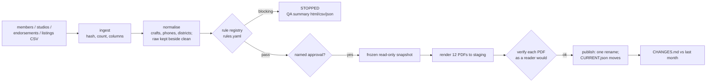

# Atlas License Directory

Part of **CivicWorks Automation Lab**, a set of independently built demonstrations on invented data.

The fictional *Four Districts Craft Coalition* publishes a monthly printed directory of endorsed
craftspeople and their studios: one PDF per district (Cinderreach, Larkmoor, Saltwick, Thornvale)
for each of three audiences (public, member, inspector) - twelve PDFs a month. This project builds
them end to end: four independent source catalogs in, checked and frozen data in the middle,
verified, navigable PDFs out, with the previous month always recoverable.

## The problem

A printed directory multiplies every data error twelve times, and once it is out it cannot be
recalled. The usual failures: a craftsperson listed after their endorsement lapsed; one member id
shared by two people; a craft spelled three ways; a studio in a district that does not exist; someone
in the public edition who never agreed to be listed publicly; a contents page whose page numbers
drifted; a print run that stopped half way and was published anyway.

## How a release works



- **Rule registry** (`atlas/rules.yaml`): nine rules, each with severity, rationale and fix. Six block
  (duplicate member id, missing or expired endorsement, impossible dates, unknown craft, orphaned
  studio, contradictory audience); two are advisory (missing venue token, possible duplicate person).
- **Raw values kept.** Crafts are mapped from many spellings to 12 codes, phone numbers to one format,
  districts to known codes - and the original text is stored beside every cleaned value.
- **Exact duplicates collapse; near-duplicates never merge.** A repeated listing row collapses by its
  key; two ids with 97%-alike names go to a review report.
- **Freeze needs a person.** The checked tables are copied to a read-only snapshot only with a named
  approver; a frozen period is never re-frozen. Printing reads only the snapshot.
- **Layout is planned first,** so the contents page and the index know every page number before
  anything is drawn: cover, linked contents, one section per craft, alphabetical index with links,
  bookmarks, and a footer on every page.
- **Verification opens each finished PDF** and checks the page count, that the last page is the index,
  that every contents link lands on its section, that every index entry lands on a page printing that
  name, the bookmarks, the footers and the metadata.
- **Checkpoints.** Each stage records a hash of what it produced. After a crash, `--resume` skips
  stages whose output still hashes the same and redoes any whose output changed.
- **Atomic publish and safe rollback.** A verified folder moves into `published/<period>/` in one
  rename; `CURRENT.json` says which period readers get. Rollback re-hashes every file first.

## Run it

```bash
pip install -e ".[dev]"
python -m atlas demo --out build/demo
python -m pytest                     # 12 tests
```

Step by step: `python -m atlas generate --workspace w --with-problems`, then
`python -m atlas run --workspace w` (stops at the checks), fix the sources, `run --approve "directory
editor"`, and `rollback --to 2026-11`.

## Tests

12 tests: normalisers; same seed, same sources; every planted problem is found and blocks; freeze
needs a named approver and is read-only; each PDF has the structure a reader needs; editions follow
their audience rules; verification catches a damaged PDF (missing index, unreadable file); a crash
after printing resumes without redoing work; a stage whose output changed is redone; the next period
reports its changes and rollback refuses a tampered release; a frozen period is never refrozen; the
demo runs.

## How this was built

The author set the problem, the rules, the points where a person must decide, and the acceptance
tests, and reviewed the results. The code and most of the documentation were written with AI coding
assistance working to that design. Nothing here is claimed without a test in this repository.
Every person, studio, district and endorsement is invented.

## License

MIT.
