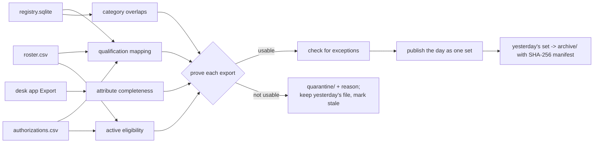

# LedgerGuard Data Quality

Part of **CivicWorks Automation Lab**, a set of independently built demonstrations on invented data.

The fictional *Ledger Equipment Cooperative* rents out excavators, lifts, generators and saws from
four depots. Every day four quality checks run over three source systems - an equipment database,
a technician roster, an authorisation list - and one old desktop program whose only way to share data
is an "Export" button. LedgerGuard runs those checks so that a file that merely *exists* is never
mistaken for a good export, and so that yesterday's good results can always be put back.

## The problem

Export jobs fail quietly. The desktop program says "Export complete" and writes a header with no rows.
An update renames a column. A job stops a third of the way through. The scheduler sees a file with
today's date and reports success, and every report built on it is wrong. Meanwhile the previous good
output has been overwritten.

## A day's run



**Proving an export** means all of: the file exists; its columns are exactly the expected ones; its
row count equals what the source itself says it has; no key is blank. Anything else is moved to
`quarantine/<day>/` with the exact reason, and the job's previous verified file is carried forward,
marked stale on the dashboard.

| job | sources | what an exception means |
|---|---|---|
| qualification_mapping | database + two CSVs | equipment of a class at a depot where nobody is authorised for it |
| attribute_completeness | desk app export | an item with no serial or no last-service date |
| category_overlaps | database | one serial number registered under two classes |
| active_eligibility | two CSVs | a technician marked active with every authorisation lapsed |

Each day's outputs - four CSVs, `exceptions.xlsx` (a summary tab and a tab per job) and
`dashboard.html` - are published as one set under `current/`. Before that, the previous set moves to
`archive/<day>/` with its manifest. `restore --day` puts an archived set back only if every file still
matches its manifest; the set it replaces is kept too.

## Run it

```bash
pip install -e ".[dev]"
python -m ledgerguard demo --out build/demo       # four days, two export failures, a restore
python -m pytest                                  # 13 tests
```

Step by step: `init`, `run --date 2026-11-23`, `run --date 2026-11-24 --desk-mode empty`
(or `renamed-column`, `truncated`), `restore --day 2026-11-23`.

## Tests

13 tests: same seed, same sources; five ways a file can exist and still not be a usable export (none,
header only, changed columns, short, blank keys); a healthy day finds every planted problem and writes
the workbook and dashboard; three kinds of bad desk export are quarantined while yesterday's file is
kept and marked stale; every job is logged with expected and observed rows; restore refuses a tampered
archive and restores an intact one; the demo runs.

## How this was built

The author set the problem, the rules, the points where a person must decide, and the acceptance
tests, and reviewed the results. The code and most of the documentation were written with AI coding
assistance working to that design. Nothing here is claimed without a test in this repository.
Every depot, item and technician is invented.

## License

MIT.
