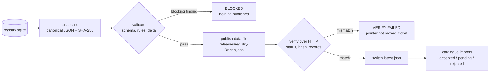

# OpenBadge Registry Publisher

Part of **CivicWorks Automation Lab**, a set of independently built demonstrations on invented data.

A fictional skills academy, *Lantern Skills Academy*, publishes a public, machine-readable registry of
the continuing-education badges its learners hold. An outside catalogue imports that registry. This
project is the release process between the two: it builds the registry from a database, checks it,
publishes it, proves the published copy is right, and only then tells consumers it is the latest.

## The problem

A public data file has two failure modes that matter. Bad records go out (a duplicated badge, an
expiry date before the issue date), or a good file goes out badly (an upload cut off half way, a file
that never arrived, a pointer to something deleted). Either way every consumer imports the damage.
And when something does go wrong, someone has to be able to put the last good version back quickly
and prove it is the right one.

## How a release works



- **Canonical JSON.** Sorted keys, fixed separators, UTF-8, one trailing newline: the same data always
  produces the same bytes, so a SHA-256 identifies the content.
- **Three layers of checks.** A JSON Schema for shape; rules for meaning (unique badge ids, real dates,
  expiry after issue, nothing issued after the release date, badge types from a controlled list); a
  delta check against the live release (more than 20% of badges vanishing blocks unless
  `--accept-drop` is given).
- **Immutable data files.** Each release writes a new dated file. An existing release file is never
  overwritten; a second attempt with the same name fails.
- **Verify, then point.** The data file is fetched back over HTTP from a local server and compared
  byte for byte before `latest.json` moves. A cut-off or missing upload never becomes "latest".
- **Technical versus business status.** A release can be *verified* (technically correct) while the
  catalogue's import is still *pending*, then *accepted* or *rejected*. Both are recorded separately.
- **Safe rollback.** `rollback` moves the pointer back only to a release that verified, whose file
  still exists, still matches its recorded hash, and still verifies over HTTP.
- **Evidence.** Every release, including blocked and failed ones, leaves `runs/<release>/manifest.json`
  (stages, input and output hashes, seed, versions, verdict) and `findings.json`. Failures open a
  correction ticket in `tickets/`.

## Run it

```bash
python -m venv .venv
.venv/Scripts/python -m pip install -e ".[dev]"     # Mac/Linux: .venv/bin/python
python -m openbadge demo --out build/demo          # the whole story, including the failures
python -m pytest                                   # 13 tests
```

Or step by step on a workspace:

```bash
python -m openbadge init --workspace build/ws
python -m openbadge release --workspace build/ws --dry-run
python -m openbadge release --workspace build/ws
python -m openbadge consume --workspace build/ws
python -m openbadge rollback --workspace build/ws --to R0001
python -m openbadge status --workspace build/ws
```

## What the demo shows

| scene | what happens | what it proves |
|---|---|---|
| 1 | 120 learners and about 300 badges generated from seed 20261123 | reproducible synthetic data |
| 2 | first release verifies over HTTP; the catalogue accepts it | the happy path, end to end |
| 3 | a duplicated badge and a 30 February expiry are planted | bad records are blocked, with the record named |
| 4 | the data is fixed but the upload is cut off half way | a damaged file never becomes "latest"; a ticket opens |
| 5 | the release is rerun; the catalogue imports it a day later | pending and accepted are tracked apart from "verified" |
| 6 | rollback to the failed release is refused; rollback to the last good one works | rollback only to something proven good |
| 7 | release history | every attempt is on record, not just the successes |

## Tests

13 tests: same seed gives the same bytes; migrations apply once and foreign keys hold; a release is
verified before the pointer moves; duplicates and impossible dates block with nothing published; a
cut-off or missing upload never becomes latest; a large drop needs explicit acceptance; a dry run
publishes nothing; delayed consumer import keeps technical and business status apart; a stale pointer
is rejected by the consumer and rollback recovers; rollback refuses a release that never verified or
whose file was altered; release files are immutable; the demo runs end to end.

## Layout

```
db/migrations/        numbered SQL migrations (schema_version tracked)
openbadge/
  db.py               connect + migrate
  synth.py            seeded learners/badges and the planted defects
  registry.py         payload, canonical bytes, validation (schema + rules + delta)
  registry.schema.json
  site.py             local HTTP server and fetch
  release.py          release, consume, rollback, status
  runkit.py           hashes, atomic writes, run manifest (shared across CivicWorks)
  cli.py              python -m openbadge
docs/data_dictionary.md
tests/
```

## Data

Everything is synthetic: the academy, learner aliases (`amber-heron-042`, never names), badge types,
identifiers and dates come from `openbadge/synth.py` and a fixed seed. Every published file carries a
DEMO / SYNTHETIC notice.

## How this was built

The author set the problem, the rules, the points where a person must decide, and the acceptance
tests, and reviewed the results. The code and most of the documentation were written with AI coding
assistance working to that design. Nothing here is claimed without a test in this repository.

## License

MIT.
