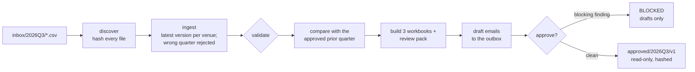

# Regional Programs Analytics

Part of **CivicWorks Automation Lab**, a set of independently built demonstrations on invented data.

The fictional *Harbor Arts Network* runs 16 studios in four invented regions (Northfield, Eastmere,
Southbank, Westvale). Every quarter each venue sends a CSV of attendance, sessions, first-time
visitors, complaints, improvements and incidents. This project turns those files into three Excel
workbooks for different readers, refuses to approve a quarter whose data is incomplete or
inconsistent, and freezes a quarter once it is approved.

## The problem

Quarterly reporting fails quietly. A venue does not send its file and the region looks like it
collapsed. A total does not match its parts. Someone sends version 2 and both get counted. A file for
last quarter lands in this quarter's folder. An approved report gets regenerated over the top of
itself after the source changed. Each of these produces a believable, wrong report.

## How a quarter runs



| check | severity | what it catches |
|---|---|---|
| `missing_contributor` | blocking | an active venue with no usable submission |
| `totals_reconcile` | blocking | category attendance that does not add up to the reported total |
| `wrong_period` | advisory (the venue then counts as missing) | a file whose rows are for another quarter |
| `duplicate_submission` | advisory | several versions: the highest is used, the rest kept as superseded |
| `prior_quarter` | advisory | last quarter not approved, so the comparison is provisional |
| `stale_prior_quarter` | blocking | last quarter's approved inputs changed after approval |
| `changed_since_approval` | blocking | this quarter is approved but its inputs no longer match |
| `large_swing` | advisory | attendance moved more than 40% like-for-like; commentary needed |

- **One accepted submission per venue and quarter** is enforced by a partial unique index in SQLite,
  not just by the code.
- **Like-for-like comparison.** Swings are computed only over venues that reported in both quarters,
  so a missing file shows up as a missing contributor, not as a drop in attendance.
- **Live formulas.** Summary and By Region totals are `SUM`/`SUMIFS` formulas over the venue rows, so a
  reader can trace any figure back to the venue that reported it.
- **Approval freezes the quarter.** Approved workbooks are copied to `approved/<quarter>/v<n>/`,
  made read-only, and hashed with their inputs in `report_release`. Approving again does nothing
  unless `--new-version` is given, which creates `v2` beside `v1`.
- **Drafts only.** Distribution messages are `.eml` drafts in `outbox/`; there is no mail-sending code.

## Run it

```bash
python -m venv .venv
.venv/Scripts/python -m pip install -e ".[dev]"
python -m regional demo --out build/demo          # two quarters, the problems, the late files, approval
python -m pytest                                  # 11 tests
```

Step by step:

```bash
python -m regional init --workspace build/ws
python -m regional run --workspace build/ws --quarter 2026Q2 --approve "program director"
python -m regional run --workspace build/ws --quarter 2026Q3
```

## The workbooks

`Studio_<Q>.xlsx` and `Outreach_<Q>.xlsx`: About (status, notice), Summary (KPIs as formulas and an
attendance-by-region chart), By Venue, By Region (SUMIFS), Quarter Comparison, QA Checks.
`Incidents_<Q>.xlsx`: minor and reportable incidents by venue with totals. `Review_pack_<Q>.md`: the
checklist, every finding, and the variance commentary still to write.

## Tests

11 tests: same seed gives the same submission files; a clean quarter is ready, approval freezes it and
a second approval replaces nothing; each planted problem is found and named; the database refuses a
second accepted submission; late files clear the block; a changed prior quarter blocks the comparison;
an unapproved prior quarter makes it provisional; workbooks carry formulas, the chart and the status;
distribution is draft-only; every run leaves a manifest; the demo runs end to end.

## Data

All synthetic, from `regional/synth.py` and a fixed seed. Venue names are invented ("Northfield Kiln
House"); recipients use example.org addresses.

## How this was built

The author set the problem, the rules, the points where a person must decide, and the acceptance
tests, and reviewed the results. The code and most of the documentation were written with AI coding
assistance working to that design. Nothing here is claimed without a test in this repository.

## License

MIT.
