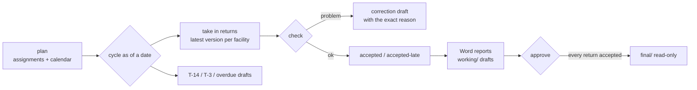

# SafeSite Compliance Cycle

Part of **CivicWorks Automation Lab**, a set of independently built demonstrations on invented data.

The fictional *Meridian Facilities Consortium* runs twelve workshops and depots in three invented
districts. Every quarter, four coordinators (known only by role) return a spreadsheet of safety
observations for each facility. This project runs that cycle: it plans the deadlines, drafts the
reminders each day calls for, checks every return, asks for corrections with the exact reason,
escalates what is overdue, and produces two different Word reports. Drafts, QA material and approved
finals stay in separate folders, and a final is never overwritten.

## The problem

A quarterly return cycle depends on people. Someone forgets, someone sends a sheet whose totals do not
match its rows, someone marks a serious finding with no photo reference, someone sends a severity
nobody has defined. Reminders get sent twice or not at all. A report gets finalised with two
facilities missing, then regenerated over the approved copy.

## The cycle



Checks on each return: the two sheets exist with the exact columns; observation ids are unique;
severity is one of S1-S4; action is open / in-progress / closed; every date falls in the quarter;
S3 and S4 findings carry an evidence reference; the Totals sheet matches the rows.

Reminders: T-14 and T-3 to every coordinator still open, overdue (with the safety lead copied) after
the due date, and a correction draft the moment a return fails. A unique index on (assignment, kind)
means running the same day twice drafts nothing new. There is no code that sends mail.

Reports: *Workshop & Studio Facilities* lists every significant and urgent observation;
*Warehouse & Depot Facilities* is organised around open actions by area and has a section on loading
and vehicle areas. Both carry a DEMO / SYNTHETIC header and a DRAFT or FINAL banner.

## Run it

```bash
python -m venv .venv
.venv/Scripts/python -m pip install -e ".[dev]"
python -m safesite demo --out build/demo      # the quarter from first reminder to approved finals
python -m pytest                              # 11 tests
```

## What the demo shows

| scene | as of | what happens |
|---|---|---|
| 1 | - | 12 assignments planned, calendar written |
| 2 | 1 Dec | 6 returns arrive; 3 need correction (missing evidence, bad totals, unknown severity); T-14 drafts |
| 3 | 12 Dec | corrections come back and are accepted; T-3 drafts; a re-run drafts nothing new |
| 4 | 18 Dec | two facilities overdue: escalations drafted; finals refused, drafts built instead |
| 5 | 20 Dec | late returns accepted and marked late; finals approved; a second approval overwrites nothing |
| 6 | - | working / qa / final / outbox kept apart |

## Tests

11 tests: quarter boundaries; each bad return refused with its reason; a clean return passes;
reminders follow the calendar and never duplicate; overdue drafts copy the safety lead and nothing is
sent; late returns accepted but marked late; finals need every return and are never overwritten; the
two report variants differ in content; the demo runs end to end.

## How this was built

The author set the problem, the rules, the points where a person must decide, and the acceptance
tests, and reviewed the results. The code and most of the documentation were written with AI coding
assistance working to that design. Nothing here is claimed without a test in this repository.
Every facility, coordinator and observation is invented.

## License

MIT.
